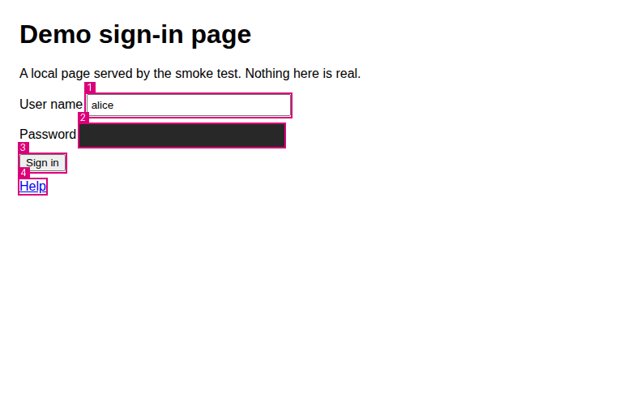

# mcp-server-diwall-browser

**English** | [Français](docs/fr-FR/README.md) | [Deutsch](docs/de-DE/README.md) | [Español](docs/es-ES/README.md)

An MCP server that gives a language model the eyes and hands of an operator in the operator's own
browser, through the Chrome DevTools Protocol: the model sees the same screenshot and the same
accessibility tree as the operator, and acts in the same authenticated session. It needs a
Chromium-family browser that the operator starts with a dedicated profile and a debugging port
bound to the loopback interface, and an encrypted directory (gocryptfs) for credentials, evidence
and downloads.

## Connect it to an MCP client

The server speaks MCP over standard input and output. With Claude Code:

```
claude mcp add --scope user diwall-browser \
  -e MCP_DIWALL_BROWSER_PROFILE=~/.config/mcp-server-diwall-browser/profile.json \
  -- ~/mcp-server-diwall-browser/.venv/bin/python -m mcp_server_diwall_browser
```

For another MCP client, the generic `mcpServers` block:

```json
{
  "mcpServers": {
    "diwall-browser": {
      "command": "~/mcp-server-diwall-browser/.venv/bin/python",
      "args": ["-m", "mcp_server_diwall_browser"],
      "env": {
        "MCP_DIWALL_BROWSER_PROFILE": "~/.config/mcp-server-diwall-browser/profile.json"
      }
    }
  }
}
```

Adapt `~/mcp-server-diwall-browser` to where you cloned the repository, and the profile
path to where you wrote your operator profile. The variable can be left out when the operator
profile is at its standard place, `~/.config/mcp-server-diwall-browser/profile.json`. The form of
the `claude mcp add` command was checked against `claude mcp add --help`, then run by the operator
on Debian: `claude mcp list` showed the server connected. The tests start the server exactly as
these two blocks do:
`python -m mcp_server_diwall_browser` with `MCP_DIWALL_BROWSER_PROFILE` set.

Everything that comes before (installing, starting the browser, opening the encrypted directory,
writing the operator profile) is in [docs/OPERATOR_GUIDE.md](docs/OPERATOR_GUIDE.md). How it works
and why is in [docs/ARCHITECTURE.md](docs/ARCHITECTURE.md).

## What the model sees



The image above was produced by `scripts/smoke_test.py` from the local demo page
(`docs/demo/index.html`). The numbered marks are drawn by the server: an action names an element
by its mark. The password field, which the page filled itself, is masked by a solid rectangle, and
its value is withheld from the text the model receives (`redacted_fields` is 1).

## What is tested, what is not

Tested:

- The full suite runs in this repository's test environment (Ubuntu 24.04), with Python 3.13.14 and
  the dependencies of `requirements.lock`: without a browser, 1654 tests pass and the 532 that need a
  browser are deselected (as a user other than root, one of the 1654 is skipped: a test that runs as
  root only); with Chromium 141.0.7390.37 (headless, blank temporary profile), the 532 browser tests
  pass, with no expected failure.
- Download tests: two failed at random, 7 and 8 times in 30 runs of each alone, because the server
  closed the download setting before the browser had chosen what to do with the download. After the
  change they failed 3 and 1 times in 130 runs of each alone; the 3 were a read, in the test itself, of
  a file the browser renames, which is now one helper that ignores the rename. Since then each of the
  two alone failed 0 times in 200 runs, twice over. A third test, which closed the setting at once and
  expected a late download to be refused, failed 4 times in 200 alone: the real browser can choose
  before the server closes the setting, so the test is replaced by tests on a simulated browser. The
  measures and what remains are in `docs/JOURNAL.md`.
- The operator replayed an earlier revision on Debian (Python 3.13.5) with Chrome
  154.0.8037.97: without a browser 1450 passed and 1 was skipped (a test that runs as root only);
  with it 119 passed and 6 failed as expected, the six of the page zoom, closed since;
  the two download tests alone, 0 failures in 40 runs each. The operator then replayed `919ed8c`
  (the revision before the click tests) on the same browser: without a browser 1546 passed, 1 was
  skipped and 188 were deselected; the three zoom and scale files, 125 passed; all 188 browser tests
  passed; the two download tests and the two tests that replace the unstable one, each alone, 0
  failures in 40 runs. The click tests were not replayed on it.
- `scripts/smoke_test.py` returns 0 against Chromium 141 and 3 when no browser is found.
- The marks and the masks at a screen scale of 1, 1.5 and 2, on a headless Chromium 141: the box of
  every mark in view lies within two pixels of the box the browser itself gives, every pixel of the
  password field of the demo page is under its mask, and the mask goes no further than two pixels
  beyond it (`tests/test_scale_integration.py`). Before the correction of this, a mask did not
  cover its field at a scale above 1. A real screen at 1.5 was not measured.
- The page zoom, at 100, 125, 150 and 200 % and at screen scales of 1 and 1.5, on a headless Chromium
  141 whose blank profile holds the zoom as its default: the image the model receives is the whole
  view, the password field of the demo page is under its mask, and so is the field of a page scrolled
  so that it sits near the bottom or in the middle of the view; the mask goes no further than two
  pixels beyond the field, and in the 16 placements measured no edge of a mask lay inside its field
  (`tests/test_zoom_integration.py`, `tests/test_zoom_scrolled_integration.py`). Before the
  correction, at 125, 150 and 200 %, 0 % of the field was covered and `capture` read `ok`. No image is
  published (`capture` reads `unavailable`, the tree is still served) when the browser gives no usable
  zoom, when the zoom changes during the capture, or when the image is more than two pixels from the
  size of the view on either axis (`tests/test_perception_zoom.py`, which needs no browser). On Chrome
  154 the operator measured the size of the image cut as the browser reads it (the view at each zoom, a
  pixel short in height at 125 %); the zoom tests were replayed on it later (below).
- A click of the server lands on its target at page zooms of 100, 125, 150 and 200 % and screen scales
  of 1 and 1.5, on a headless Chromium 141 whose blank profile holds the zoom as its default. The click
  is the server's own (`Actions.click`, with its gate and its limits); the test page counts what each of
  its buttons receives and a separate session reads the counts. At each of the eight combinations a
  button of 120 by 32 CSS pixels, a button of 16 by 16 between two decoys 4 pixels from it, a button two
  and a half views down, and the large button after the page was scrolled to put it in the middle of the
  view, each received exactly one click, no decoy received any and none fell outside a button. On a page
  scrolled in both directions the click lands on the button put in the middle of the view, and a button
  covered by a banner fixed to the view is refused (`element_obscured`) with nothing clicked
  (`tests/test_click_integration.py`, 264 tests; `tests/test_click_targets_page.py`, 51, and
  `tests/test_click_lookup_point.py`, 20, need no browser). The same check refuses a click sent to the
  point of the box multiplied by the zoom, divided by it, or multiplied by the screen scale (64 of 64
  such clicks reached no button), and a server that asks the browser about the point of the view. Before
  the correction, 20 of the 32 attempts at the first page failed, those that needed a scroll, and a button
  covered by the banner was accepted and the banner was clicked, at the eight combinations: the browser
  answers the node lookup for a point of the document, and the click gave it a point of the view. The
  measures are in `docs/JOURNAL.md`.
- A click on a page that moves when the pointer first moves (a menu that opens on hover, a banner that
  slides in). The test page shifts each target 60 CSS pixels down at the first mouse movement and puts an
  intruder button where the target was. At each of the eight combinations of page zoom and screen scale,
  for each of three buttons (a large one, a 16 by 16 one between two decoys, one two and a half views
  down), a click of the server either lands once on the target or is refused as covered
  (`element_obscured`) with nothing clicked, and in the 24 attempts it is refused every time
  (`tests/test_click_shifting_integration.py`, 80 tests; `tests/test_click_shifting_page.py`, 30, and
  `tests/test_click_moving_page.py`, 10, need no browser). Before the change the same 24 attempts returned
  no error and the click landed on the intruder. After a refusal, a click on a new observation lands.
  The server now asks the browser again what lies under the point after the movement and before the press,
  every time, so a target that is covered where it stands, by a button shown at the first movement, is
  refused too (`tests/test_click_covering_integration.py`, 3 tests, on Chrome 154.0.8037.97). The 24
  attempts above were measured on Chromium 141.0.7390.37. The measures, and those of a page that scrolls
  without stopping, are in `docs/JOURNAL.md`.
- A dense page with a consent banner fixed over its lower part (643 things to click): its three
  buttons are marked and listed first in the tree, the elements under it say `covered`, and a click
  on "Refuse" by its mark takes the banner away (`tests/test_ranking_integration.py`).
- The command that carries an old credential file over (see the operator guide): on files of the
  test suite in a simulated volume, with a refusal tested for each way out, and no value in
  anything it prints. It was not tried on a real gocryptfs volume.
- A real gocryptfs 2.5.1 volume, a throw-away one made for the check (not the operator's own),
  mounted on Debian: `status` read `mounted` and `profile_encrypted: true`, and the server wrote
  its journal and created `downloads/` in it. Opera 136 (Chromium 152), started with its profile
  in that volume and a debugging port on the loopback interface, was attached; the server opened
  a page of a public shopping site, filled its search field, pressed Enter and observed the
  results. The typed text does not appear in the journal.
- Claude Code, started from a desktop terminal: `status` through Claude Code read
  `confirmation_channel: native`, so the display reached the server.
- The server process over standard input and output: it writes nothing but the protocol on its
  standard output, holds no listening socket and runs with a core file limit of zero.

Not tested:

- A real `kdialog` or `zenity` window: the tests use fake programs in their place.
- The operator's own gocryptfs volume: the tests simulate the mount table and the directory, and
  the check above used a throw-away volume.
- Brave, and Google Chrome builds other than the one the operator ran.
- The confirmation asked through a desktop MCP client (elicitation): tested with the client of
  the MCP SDK only.
- Chrome 154 with its profile kept inside the operator's own encrypted directory.
- The page zoom made by the Ctrl + key of a browser that is not headless. The protocol has no command
  for a zoom, so the tests write the default zoom of a blank profile; whether the browser keeps the
  two kinds in the same way is not confirmed. A screen whose scale really is 1.5 was not measured
  either; the click tests have the same two limits.
- The click tests on Chrome 154. The correction reads a property of the browser's node lookup measured
  on Chromium 141 (it answers for a point of the document, not of the view): if it differs on another
  version, the tests of a click on a scrolled page fail there. A click on an element inside a frame of a
  scrolled page was not measured.
- A page that moves after the second lookup of a click and before the press. On a page that scrolls by
  1000 CSS pixels a second, 6 of 144 clicks gave no error and landed nowhere; none landed on another
  button (Chrome 154.0.8037.97, `docs/JOURNAL.md`).
- A refusal in the confirmation window, answered by a person.

Known limits:

- While the server is attached to the browser, downloads are refused in every tab, the operator's
  own tabs included, except in the short window around one of the server's clicks or Enter keys.
  To download a file yourself, stop the server or the MCP client; downloads work again as soon as
  the server's connection ends.
- A download that a page starts more than half a second after a load ends is refused.
- Accepting a dialog whose message asks for a payment, a deletion or a secret change is always
  refused: no evidence can be taken while a dialog is open. The operator answers such a dialog.
- Visibility is approximate: the server does not compute contrast or `overflow` clipping, so text a
  human cannot read can still reach the model.
- An observation holds at most 150 marks and 400 tree lines (`marks_truncated`, `tree_truncated`).
  Past that, the server keeps first what is in a layer above the page (a dialog, a modal node, a
  fixed or sticky node painting over content in view, such as a cookie banner), listed under an
  `overlay` line in the tree, then what is in view and clear, then what is in view under a layer
  (`covered: true`, and a click on it is refused), then the rest. A banner that overlaps nothing in
  view is not a layer and can still be cut.
- The content of frames is never read; frames are masked in the image.
- What the model provider keeps of what it receives is not confirmed by this project.

## Credits

mcp-server-diwall-browser is built in an asymmetric human–LLM collaboration. The roles are written
down as they were actually played; the full list is in [CONTRIBUTORS.md](CONTRIBUTORS.md).

- **Ronan Davalan**: architect and arbiter. Vision, security requirements, decisions, validation and testing.
- **Claude Code (Anthropic)**: systems engineer and lead developer. Server implementation, tests, documentation, and the working framework.
- **Claude Cloud (Anthropic)**: wrote part of the code on branches, from prompts, reviewed before every merge.
- **Gemini (Google)**: architectural advisor and synthesizer; gave the project its name, **Diwall**, "dike" in Breton.
- **Space Bunny Free (opencode)**: cleanup and pruning of the project's working framework at the start of the project.
- **Local vision**: Qwen3-VL (Alibaba), run through Ollama, for the optional visual location and comparison.

License: not chosen yet.
